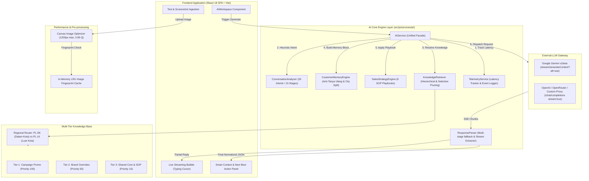
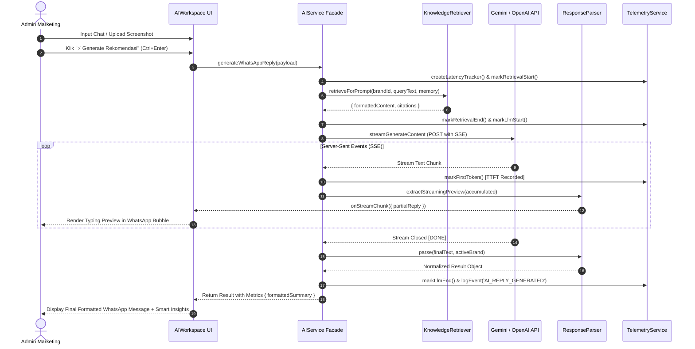

# DOKUMENTASI ARSITEKTUR: INTERIOR SALES AI COPILOT
**Versi:** 2026.2 (Post-Upgrade)  
**File:** `/docs/AI-ARCHITECTURE.md`  
**Status:** PRODUCTION ARCHITECTURE DOCUMENTATION  

---

## 1. PENDAHULUAN & TUJUAN ARSITEKTUR

Sistem **Interior Sales AI Copilot** dirancang sebagai mesin augmentasi kecerdasan penjualan (Sales Intelligence Augmentation) untuk admin marketing WhatsApp pada industri manufaktur interior custom furniture dan design-and-build.

Tujuan utama dari arsitektur ini adalah:
1. **Ultra-Fast Perceived Response (TTFT < 800ms):** Memberikan preview balasan WhatsApp secara real-time melalui Server-Sent Events (SSE) streaming sehingga admin tidak perlu menunggu freeze 5–8 detik.
2. **Context-First & Zero AI Slop:** Menjawab topik atau pertanyaan spesifik terakhir calon klien tanpa halusinasi harga, tanpa basa-basi robotik, dan membatasi rekomendasi pada 1 balasan WhatsApp terbaik siap kirim.
3. **Multi-Brand Tenant Isolation:** Mendukung 5 brand (Nacira Studio, Homeputra Interior, Heya Interior, Putra Interior, Kurnia Interior) tanpa kebocoran data, harga, alamat workshop, atau identitas admin.
4. **Anti-Tanya Ulang (Persistent Client Memory):** Mencegah pertanyaan berulang atas data yang sudah disebutkan calon klien (nama, kota, ukuran ruangan, alokasi anggaran).

---

## 2. DIAGRAM ARSITEKTUR SISTEM LENGKAP



---

## 3. MODULARISASI KOMPONEN AI

Struktur modul di `src/js/services/ai/`:

| Modul | File | Peran & Tanggung Jawab Utama |
|---|---|---|
| **Unified Facade** | `src/js/services/ai.js` | Mengorkestrasi seluruh alur prompt building, latency tracing, streaming dispatch, dan normalisasi. |
| **Conversation Analyzer** | `ConversationAnalyzer.js` | Mengklasifikasikan 26 jenis intent, 15 tahapan penjualan, suhu prospek (HOT/WARM/COLD), dan ekstraksi entitas. |
| **Customer Memory** | `CustomerMemoryEngine.js` | Membentuk blok anti-tanya-ulang, klasifikasi wilayah kota (PL DK vs PL LK), dan sinkronisasi ke data lead CRM. |
| **Sales Strategy** | `SalesStrategyEngine.js` | Menyediakan SOP taktis untuk 6 Response Modes (Smart Reply, Price, Survey, Objection, Follow-up, Closing). |
| **Knowledge Retriever** | `KnowledgeRetriever.js` | Mengambil chunk harga dan materi yang relevan berdasarkan query intent dan lokasi kota klien. |
| **Response Parser** | `ResponseParser.js` | Ekstraksi preview streaming real-time, toleransi markdown wrapping, pemulihan regex darurat jika JSON terpotong. |
| **Telemetry & Latency** | `src/js/services/telemetry.js` | Menghitung durasi retrieval, LLM TTFT, total latency, masking PII nomor telepon, dan event logging. |

---

## 4. FLOWCHART EKSEKUSI REQUEST



---

## 5. TENANT ISOLATION GUARANTEES

1. **Scoped Storage:** Data knowledge brand disimpan dengan atribut eksplisit `brandId`. Chunk dengan `scope: 'GLOBAL'` hanya memuat pengetahuan teknis umum (cara ukur, standar bahan multiplex, skema termin). Seluruh harga spesifik, diskon, alamat studio, dan nomor kontak wajib berstatus `BRAND_OVERRIDE` atau `CAMPAIGN`.
2. **System Prompt Hardening:** Tag sistem core memuat instruksi mutlak:
   ```
   DILARANG KERAS menyebut brand lain seperti "NACIRA STUDIO" jika brand aktif adalah "{brandName}".
   ```
3. **Workspace Boundary:** Role `MARKETING_ADMIN` diikat secara kriptografis pada brand miliknya sehingga dilarang menukar konteks ke brand lain tanpa otorisasi Super Admin.
