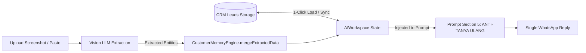

# ARSITEKTUR MEMORI KLIEN: ANTI-TANYA ULANG (PERSISTENT CLIENT MEMORY)
**Versi:** 2026.2  
**File:** `/docs/AI-MEMORY.md`  
**Status:** PRODUCTION MEMORY SYSTEM SPECIFICATION  

---

## 1. LATAR BELAKANG & TUJUAN BISNIS

Salah satu keluhan terbesar calon klien interior saat berkomunikasi dengan admin marketing via WhatsApp adalah **"Pertanyaan Berulang"** (Repeated Questioning):
- Klien sudah menyebutkan rumahnya di Bandung, tetapi admin masih bertanya *"Lokasi proyeknya di mana ya Kak?"*.
- Klien sudah mengirimkan ukuran ruangan atau denah arsitek, namun admin masih menanyakan *"Boleh tahu ukuran panjangnya?"*.

Sistem **Anti-Tanya Ulang (Zero-Repetition Engine)** pada Interior Sales AI Copilot dirancang untuk:
1. Menyimpan data kontekstual yang telah terkonfirmasi.
2. Menginstruksikan LLM secara eksplisit dengan larangan mutlak menanyakan data yang telah diketahui.
3. Mengarahkan percakapan langsung ke estimasi angka atau penawaran jadwal survei gratis.

---

## 2. SKEMA DATA MEMORI KLIEN (`CustomerMemorySchema`)

Objek memori dikelola melalui `CustomerMemoryEngine.js`:

```typescript
interface CustomerMemory {
    name: string;             // Nama sapaan klien (e.g., "Ibu Rina", "Pak Budi")
    location: string;         // Lokasi fisik/perumahan (e.g., "Podomoro Park Buah Batu Bandung")
    cityCategory: 'PL_DK' | 'PL_LK' | 'UNKNOWN'; // Kategori acuan harga
    dimensions: string;       // Dimensi ruangan (e.g., "3.5m x 2.2m tinggi 2.8m")
    budget: string;           // Rentang anggaran (e.g., "Rp 25 - 35 Juta")
    projectType: string;      // Tipe pekerjaan (e.g., "Kitchen Set Minimalis & Minibar")
    notes: string;            // Catatan preferensi (e.g., "Suka motif marmer putih, sink hitam")
}
```

---

## 3. ALUR KERJA MEMORI (BIDIRECTIONAL SYNC)



### 1. Inisialisasi dari CRM Lead
Ketika admin memilih nama prospek dari dropdown CRM:
- Data `name`, `projectType`, dan `budget` langsung ditarik ke dalam memory drawer.
- Kategori kota dihitung secara instan menggunakan `detectCityCategory(lead.location)`.

### 2. Auto-Ekstraksi dari Tangkapan Layar & Chat
Ketika admin mengunggah screenshot WhatsApp calon klien:
- Vision LLM membaca riwayat chat dan mengembalikan objek `clientAnalysis`:
  ```json
  {
    "extractedLocation": "Gading Serpong, Tangerang",
    "extractedBudget": "Maksimal 40jt",
    "projectType": "Wardrobe Master Bedroom"
  }
  ```
- Fungsi `mergeExtractedData()` memperbarui memori lokal secara otomatis tanpa menimpa data yang telah diverifikasi manual oleh admin.

---

## 4. INJEKSI ATURAN PADA PROMPT GENERATION

Pada tahap pembangunan prompt (`AIService.buildModularPrompt`), memori dikonversi menjadi format instruksi imperatif tegas:

```markdown
# CLIENT CONTEXT & MEMORY (DATA TERKONFIRMASI — DILARANG DITANYAKAN ULANG)
- Nama Klien: Ibu Rina (Gunakan sapaan sopan dengan nama ini jika cocok)
- Lokasi Terkonfirmasi: Podomoro Park Buah Batu Bandung (SUDAH DIKETAHUI, JANGAN TANYAKAN LAGI!) — Gunakan pricelist yang cocok dengan wilayah ini (PL DK (Dalam Kota))
- Dimensi Ruangan: 3.5m x 2.2m (SUDAH DIKETAHUI, JANGAN TANYAKAN LAGI!) — Langsung hitung estimasi totalnya
- Alokasi Budget Klien: Rp 30.000.000 (Sesuaikan rekomendasi agar masuk range ini)
- Tipe Rencana Proyek: Kitchen Set L-Shape
```

Hasilnya: Model AI **tidak akan pernah** menanyakan lokasi kota atau ukuran ruangan lagi, melainkan langsung menyajikan simulasi perkiraan total (contoh: 3,5m x Rp 2,8jt = estimasi awal Rp 9,8jt) dan menawarkan survei fisik gratis ke lokasi.
